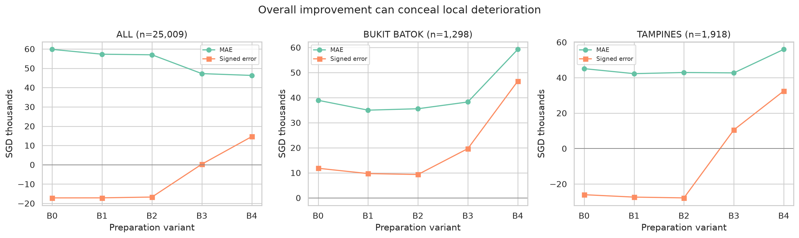

# 预测误差解释与复核记录

本次补充聚焦 BUKIT BATOK、TAMPINES 的误差恶化，以及历史地址编码造成的整体高估。主代码和已执行输出位于 `hdb_resale_eda.ipynb` 第 15 节，汇总表与图位于 `error_analysis_outputs/`。PPT 要点和讲稿分别位于 `presentation_slide_points.md` 与 `presentation_script.md`。

## 结果

所有模型使用同一批 25,009 条清洗后的 2025 年测试交易，金额单位为 SGD。平均误差为预测值减实际值，正数表示高估。

| 范围 | 测试记录 | B0 MAE | B3 MAE | B4 MAE | B4 平均误差 |
|---|---:|---:|---:|---:|---:|
| 全部 | 25,009 | 59,789 | 47,232 | 46,298 | +14,603 |
| Bukit Batok | 1,298 | 38,932 | 38,261 | 59,242 | +46,571 |
| Tampines | 1,918 | 45,082 | 42,693 | 55,955 | +32,487 |

### 1. 恶化发生在哪一步

两地 B0 → B2 的类别与函数形式准备均使 MAE 小幅降低。最大恶化出现在加入历史地址编码的 B3 → B4：Bukit Batok 增加 20,981 SGD，Tampines 增加 13,262 SGD。B4 在两地全年 12 个月的 MAE 均高于 B0，显示持续的误差问题。

### 2. 不能只归因于房型占比或稀有标签

2025 年 4 ROOM 与 5 ROOM 内部的 MAE 恶化，合计贡献 Bukit Batok 22,058 SGD、Tampines 12,652 SGD。两者均超过所在地区的净恶化金额，因为其他房型部分改善，抵消了一部分恶化。

保持 2025 年各房型内部误差不变，改用 2024 年房型占比加权，恶化仍为 19,555 SGD、10,516 SGD；与实际差异只有 755 SGD、357 SGD。因此仅这一层面的房型占比变化不足以解释主要恶化。房型内部的其他属性变化仍可能有关。

### 3. 地址支持度需要分地区解释

支持度指同一 Town + Street + Block 在 2017–2024 年的历史成交数；无完整楼栋历史时，原编码回退至父层级。

- Tampines：无历史或仅 1–9 条历史的地址占 430/1,918（22.4%）条测试记录，贡献约 84.2% 的 B4 相对 B3 MAE 增加。额外误差集中于低支持度地址。
- Bukit Batok：几乎全部正向恶化贡献出现在 10–99 条历史的地址，不能统一用“小样本”解释。

这些是误差集中情况的描述，不是地址支持度导致误差的因果证明。

### 4. 地址编码带来误差大小与校准的取舍

B3 → B4 整体 MAE 仅改善 934 SGD，平均误差却从 +330 增至 +14,603 SGD。两地平均预测值分别增加 26,910 SGD、21,946 SGD。

精确对数预测分解同时纳入地址项、截距、smearing、地区、时间和房屋属性系数变化。各项加总重构 log(B4/B3)，逐条最大误差小于 6e-15。部分系数项大幅抵消，因此不能仅凭地址编码系数解释全部变化。B4 的 smearing 系数低于 B3，其方向也不足以解释高估增加。

保持训练好的 B4 系数及其他输入不变，仅将测试地址历史从截至 2024 年冻结为截至 2023 年，得到以下平均误差：

| 范围 | B3 | B4 | B4 固定模型、历史截至 2023 |
|---|---:|---:|---:|
| 全部 | +330 | +14,603 | +1,787 |
| Bukit Batok | +19,661 | +46,571 | +33,788 |
| Tampines | +10,541 | +32,487 | +1,916 |

这说明模型对最新历史价格信息敏感，尤其是 Tampines。Bukit Batok 冻结后仍明显高估，所以近期历史变化只能解释其问题的一部分。原始历史价格可能混合地点、房屋构成与市场时间信息，这是与结果一致的待验证解释，未被识别为唯一原因。

### 5. 不确定性和使用边界

按公共楼栋地址对同一记录的 MAE 差值聚类抽样 1,000 次，随机种子为 20261014。B4 相对 B3 的差值及 95% percentile bootstrap 区间为：

| 范围 | MAE 差值 | 95% 区间 |
|---|---:|---:|
| 全部 | -934 | -1,973 至 +55 |
| Bukit Batok | +20,981 | +15,168 至 +26,865 |
| Tampines | +13,262 | +7,843 至 +18,898 |

整体边际改善的区间包含零。区间未覆盖所有空间和时间相关性，且这两个地区是在看过原测试输出后选定的，分析属于探索性诊断。

冻结实验改变了原有特征分布，只用于诊断。不能据此选择冻结策略、用 2025 平均误差做纠偏，或根据这些结果调地区权重。后续应预先定义按时间归一化或基于残差的地址编码，在验证集选择，再用新的未触碰时间段确认。

## 本次操作与验证

1. 对照 Git 历史确认各成员新增内容，并在 notebook 的贡献表中记录主要职责。
2. 使用官方 2017-01 至 2025-12 快照，SHA-256 为 `af2ed6574d542771426bf2236c122470d64fe9841ba8bd02bfb72e8a949651b1`，与原分析一致。
3. 在新内核中从头执行整份整合 notebook，包括补充房型占比和支持度贡献单元格；无错误输出。
4. 核对 B0–B4 全部使用同一份清洗样本，并确认排除记录未重新进入训练、验证或测试框架。
5. 检查测试记录配对、12 个月覆盖、房型和支持度贡献加总、逐条与汇总预测差分重构。
6. 重新生成受清洗规则影响的汇总表、图像和说明，并检查所有本地图片链接。

执行环境为项目 `uv.lock` 锁定的 Python 3.11 环境。整份 notebook 已从头执行，无错误输出；所有绘图均保存到本地。

从项目根目录按 README 运行 notebook，第 15 节会重新生成汇总 CSV 与 4 张图。原始交易及逐条处理结果继续由 `.gitignore` 排除。版本、数据校验值和验证摘要见 `error_analysis_outputs/validation_summary.json`。

OpenAI Codex 辅助代码、分析建议与写作；验证包括完整执行、原指标复现、重构与汇总检查、表格和图像审查。组员仍须理解和独立审核，成员贡献与独立复核表由小组真实填写。

来源：[原仓库](https://github.com/ParrotG/SG_HDB_Resale)、[HDB 官方数据](https://data.gov.sg/datasets/d_8b84c4ee58e3cfc0ece0d773c8ca6abc/view)。
